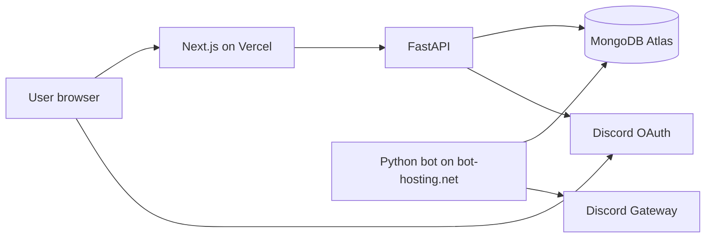

# AIO Discord Bot + Dashboard

Monorepo with three deployable parts:

| Folder | Stack | Host |
|--------|--------|------|
| `bot/` | Python, discord.py, slash commands | [bot-hosting.net](https://bot-hosting.net) |
| `dashboard-api/` | FastAPI, MongoDB, Discord OAuth | Render, Railway, Fly.io, etc. |
| `dashboard/` | Next.js 14 | [Vercel](https://vercel.com) |

Vercel runs the **Next.js UI only**. FastAPI must be deployed separately (free tiers on Render/Railway work well) because Vercel is not ideal for long-running Python APIs.

## Architecture



## 1. Discord application

1. Create an app at [Discord Developer Portal](https://discord.com/developers/applications).
2. **Bot** tab: reset token, enable **Message Content** and **Server Members** intents.
3. **OAuth2** → Redirects: add  
   `http://localhost:3000/auth/callback`  
   and `https://YOUR-VERCEL-DOMAIN/auth/callback`
4. Copy **Client ID** and **Client Secret**.

Invite the bot (replace `CLIENT_ID`):

```
https://discord.com/api/oauth2/authorize?client_id=CLIENT_ID&permissions=268443648&scope=bot%20applications.commands
```

## 2. MongoDB Atlas (free)

Create a cluster and database (e.g. `aio_bot`). Put the connection string in both `bot/.env` and `dashboard-api/.env` as `MONGODB_URI`.

## 3. Bot (bot-hosting.net)

1. Copy `bot/.env.example` → `bot/.env` locally for testing.
2. Upload `bot/` or connect Git; main file: `main.py`.
3. Set env vars in the panel (same as `.env.example`).
4. See `bot/hosting.md` for details.

Local run:

```bash
cd bot
pip install -r requirements.txt
python main.py
```

## 4. Dashboard API (FastAPI)

```bash
cd dashboard-api
pip install -r requirements.txt
cp .env.example .env
# edit .env — DISCORD_REDIRECT_URI must match Next.js callback URL
uvicorn main:app --reload --host 0.0.0.0 --port 8000
```

Deploy example (Render): New **Web Service**, root `dashboard-api`, start command  
`uvicorn main:app --host 0.0.0.0 --port $PORT`

Set `CORS_ORIGINS` to your Vercel URL.

## 5. Dashboard (Vercel)

```bash
cd dashboard
npm install
cp .env.example .env.local
# NEXT_PUBLIC_API_URL=https://your-api.onrender.com
npm run dev
```

On Vercel: import the `dashboard` folder as the project root. Environment variables:

- `NEXT_PUBLIC_API_URL` — public FastAPI URL
- `NEXT_PUBLIC_DISCORD_CLIENT_ID` — optional display/invite links

Update `dashboard-api` `DISCORD_REDIRECT_URI` and Discord portal redirect to production callback.

## Lavalink (music)

1. Run a [Lavalink](https://github.com/lavalink-devs/Lavalink) server (Java 17+) or use a hosted node.
2. Set in **`bot/.env`** (see `bot/.env.example`):

   - `LAVALINK_ENABLED=true`
   - `LAVALINK_HOST`, `LAVALINK_PORT`, `LAVALINK_PASSWORD`, `LAVALINK_SECURE`

3. Optional display labels for the dashboard API (`dashboard-api/.env`):

   - `LAVALINK_PUBLIC_LABEL`, `LAVALINK_PUBLIC_HOST`, `LAVALINK_PUBLIC_PORT`

4. Open **Dashboard → Server → Music** for live now playing, queue, and node status (refreshes every 5s).

## Bot slash commands

- **General:** `/ping`, `/help`, `/userinfo`, `/serverinfo`, `/avatar`
- **Utility:** `/poll`, `/say`, `/embed`
- **Moderation:** `/kick`, `/ban`, `/timeout`, `/untimeout`, `/clear`
- **Music:** `/play`, `/pause`, `/resume`, `/skip`, `/stop`, `/queue`, `/nowplaying`, `/volume`

Owner-only prefix/hybrid: `!sync` (or when mentioned) to re-sync slash commands.

## Dashboard features

- Discord OAuth (manageable guilds only)
- Per-guild welcome channel/message toggles
- Mod log channel ID
- Bot command stats
- Moderation log viewer (from bot actions)

## Security notes

- Never commit `.env` files.
- Use a strong `JWT_SECRET` and optional shared `API_SECRET` for future bot↔API webhooks.
- Rotate the bot token if leaked.
